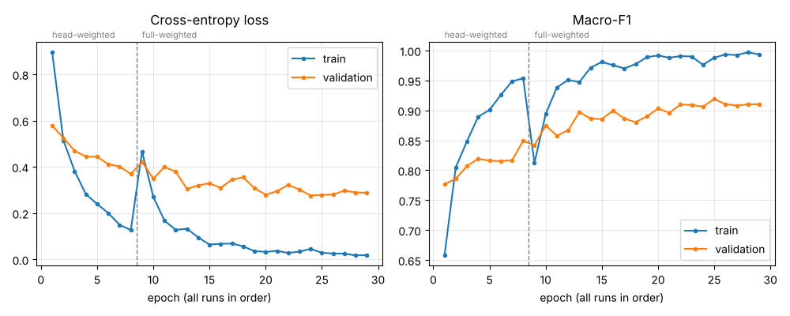
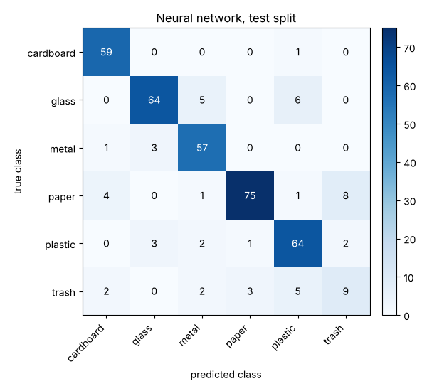
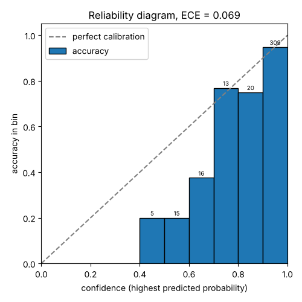
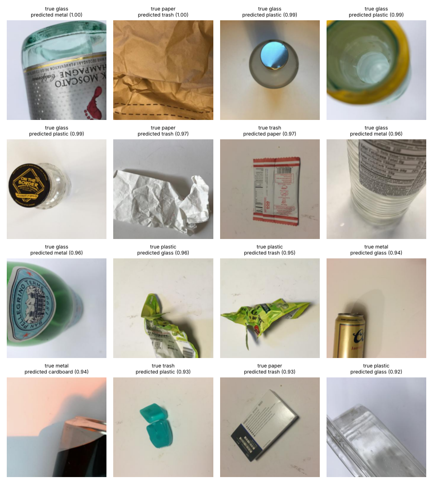
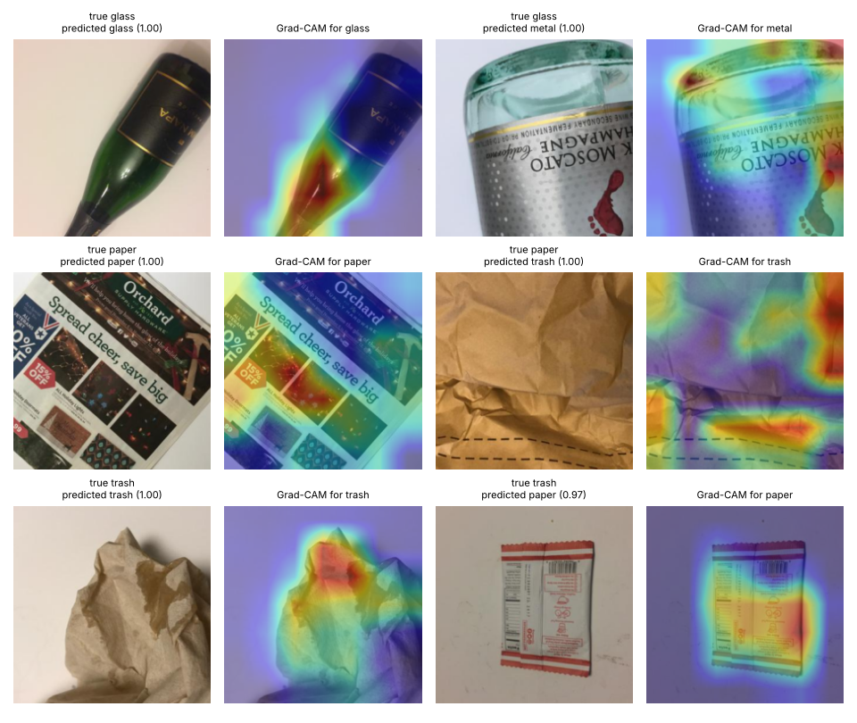
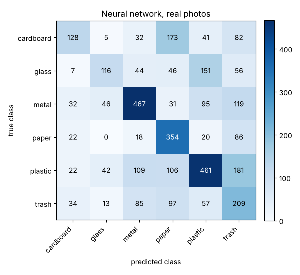
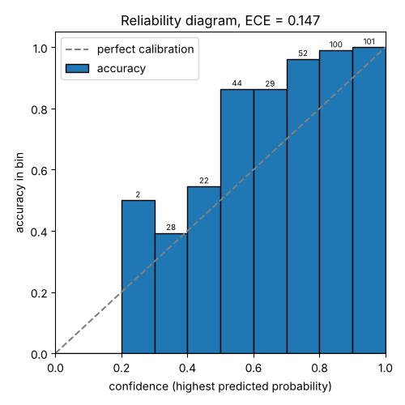
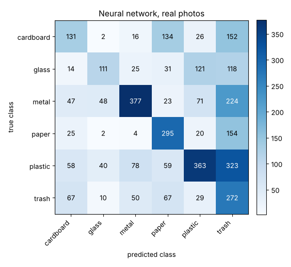

# Evaluation

All results use the fixed split in [splits/trashnet-split.csv](../splits/trashnet-split.csv) (SHA-256 `29db88fff705dfe6ee2ca24eec9e99fe4d494f4ecea9bdb36b06a39f4907e419`, 1,765 train, 378 validation and 378 test images, see [dataset.md](dataset.md)). Models and settings are chosen on the validation split only. Each final model is evaluated once on the test split. The main metric is macro-F1, because the classes are imbalanced (the test split has 21 trash images and 89 paper images).

## Classical baseline

The baseline shows how far hand-crafted image features get before any deep learning is used.

### Features

Every image is converted to RGB and resized to 128 × 128 pixels. Three descriptors are concatenated into one vector of 1,902 values:

| Descriptor | Settings | Values | What it captures |
|---|---|---|---|
| HSV colour histogram | 8 hue × 4 saturation × 4 value bins, normalised to sum 1 | 128 | Overall colour, independent of where it is in the image |
| Local binary patterns (LBP) | Grayscale, uniform patterns, 8 neighbours, radius 1, normalised histogram | 10 | Fine surface texture (smooth, edges, corners, spots) |
| Histogram of oriented gradients (HOG) | Grayscale, 9 orientations, 16 × 16 pixel cells, 2 × 2 cell blocks | 1,764 | Shape: the direction of edges in each region of the image |

The features are computed with scikit-image ([src/wastevision/baseline/features.py](../src/wastevision/baseline/features.py)).

### Model selection on validation

Each candidate is a scikit-learn pipeline that standardises the features and then fits the classifier on the train split. It is scored on the validation split, and the candidate with the highest validation macro-F1 is kept (on a tie, the first one in the table).

| Model | Parameters | Validation accuracy | Validation macro-F1 |
|---|---|---|---|
| Logistic regression | C = 0.001 | 0.672 | 0.657 |
| **Logistic regression** | **C = 0.01** | **0.704** | **0.699** |
| Logistic regression | C = 0.1 | 0.693 | 0.682 |
| Logistic regression | C = 1 | 0.693 | 0.680 |
| SVM, RBF kernel | C = 1, gamma = scale | 0.672 | 0.653 |
| SVM, RBF kernel | C = 1, gamma = 0.0001 | 0.611 | 0.541 |
| SVM, RBF kernel | C = 10, gamma = scale | 0.698 | 0.693 |
| SVM, RBF kernel | C = 10, gamma = 0.0001 | 0.688 | 0.678 |
| SVM, RBF kernel | C = 100, gamma = scale | 0.698 | 0.693 |
| SVM, RBF kernel | C = 100, gamma = 0.0001 | 0.696 | 0.693 |

The selected model is logistic regression with C = 0.01, a strongly regularised linear model. The best RBF SVMs are close behind (0.693), so the extra flexibility of a non-linear kernel does not help with these features.

### Test result

The selected pipeline was evaluated once on the test split (378 images):

| Metric | Value |
|---|---|
| Accuracy | 0.730 |
| Macro-F1 | 0.720 |

| Class | Precision | Recall | F1 | Test images |
|---|---|---|---|---|
| cardboard | 0.833 | 0.833 | 0.833 | 60 |
| glass | 0.692 | 0.720 | 0.706 | 75 |
| metal | 0.638 | 0.607 | 0.622 | 61 |
| paper | 0.817 | 0.854 | 0.835 | 89 |
| plastic | 0.627 | 0.653 | 0.640 | 72 |
| trash | 0.857 | 0.571 | 0.686 | 21 |

The test scores are slightly higher than the validation scores. With 378 images, one image changes accuracy by about 0.3 percentage points, so a difference of this size is within the normal variation between two samples of the same data.

Cardboard and paper are recognised best: they have typical colours and flat textures. Glass, metal and plastic are confused with each other most often: the largest errors in the test confusion matrix are glass predicted as plastic (11 images) and metal predicted as glass or plastic (9 images each). A likely reason is that these materials are shiny, often transparent or grey, and their appearance depends on reflections that colour, texture and edge histograms describe poorly. Trash has a high precision but a low recall: the model predicts it only 14 times for 21 trash images, which fits the small number of trash images in training.

### Reproduce

```bash
pip install -e ".[train,dev]"
wastevision data download
wastevision baseline train
wastevision baseline evaluate
```

`baseline train` prints the validation table and saves the selected pipeline to `runs/baseline/model.joblib` (not committed). `baseline evaluate` loads it and prints the test metrics. Both commands are deterministic: running them again gives the same numbers.

Measured on 2026-10-23 on a 4-core Intel Xeon CPU at 2.10 GHz with Python 3.12.3, scikit-learn 1.9.1 and scikit-image 0.26.0: feature extraction takes about 11 ms per image, `baseline train` about 70 seconds in total (feature extraction for train and validation plus all ten candidates), `baseline evaluate` about 6 seconds.

## Neural network

The network is MobileNetV3-Small, pretrained on ImageNet (`IMAGENET1K_V1` weights from torchvision), with its last layer replaced by a new layer with one output per class. It is trained in two stages on the train split, and every choice below was made on the validation split only. This model (version 1) was then evaluated once on the test split ([Test result](#test-result-1)). The sections up to the real-world check describe version 1. The final model is version 2, trained with label smoothing ([Model versions](#model-versions)).

### Training settings

| Setting | Stage 1: head | Stage 2: full network |
|---|---|---|
| Trainable layers | classifier only (backbone frozen, BatchNorm statistics fixed) | all layers |
| Starting weights | ImageNet backbone, new random last layer | best stage 1 checkpoint |
| Optimizer | AdamW, learning rate 1e-3 | AdamW, learning rate 1e-4 for the backbone and 1e-3 for the classifier |
| Learning-rate schedule | constant | cosine decay over 25 epochs |
| Epochs | 8 | at most 25, early stopping when validation macro-F1 has not improved for 4 epochs |
| Loss | cross-entropy with inverse-frequency class weights | same |
| Batch size, seed | 32, 42 | 32, 42 |

After every epoch the model is evaluated on validation, and the checkpoint with the highest validation macro-F1 is kept.

### Class weights

Trash has only 95 training images, against 416 for paper. Weighting the loss by inverse class frequency makes a mistake on a rare class cost more. Both options were trained through both stages and compared on validation:

| Loss | Stage 1 val macro-F1 | Stage 2 best epoch | Stage 2 val accuracy | Stage 2 val macro-F1 |
|---|---|---|---|---|
| unweighted | 0.8575 | 8 of 12 | 0.9206 | 0.9127 |
| inverse-frequency class weights | 0.8493 | 17 of 21 | **0.9259** | **0.9189** |

The weighted loss is slightly better after fine-tuning and is the default. The difference is small (two more validation images correct out of 378), so it is a weak preference, not a strong result. For comparison, the classical baseline reaches a validation macro-F1 of 0.699.

### Training curves



Training loss keeps falling, while validation loss levels off at about 0.28 from epoch 12 of stage 2 and training macro-F1 approaches 1.0. This growing gap is the sign of overfitting that early stopping reacts to. The jump in training loss at the start of stage 2 comes from unfreezing the backbone: its BatchNorm layers start updating their statistics and the pretrained features begin to change.

### Reproduce

```bash
pip install -e ".[train,dev]"
wastevision data download
wastevision train --stage head
wastevision train --stage full
wastevision curves --run runs/head --run runs/full
```

`train` prints one line per epoch and writes `metrics.csv` and the best checkpoint `best.pt` to `runs/head` or `runs/full` (not committed). `--no-class-weights`, `--epochs` and `--run-dir` change the settings. These sections describe version 1. Since the [model comparison](#model-versions), `train` uses label smoothing by default; add `--label-smoothing 0` to both commands to train version 1. The comparison above used `--run-dir` to keep the four runs apart. Measured on 2026-10-27 on a 4-core Intel Xeon CPU at 2.10 GHz with PyTorch 2.14.1: stage 1 takes about 3 minutes, stage 2 about 13 minutes (about 38 seconds per epoch).

### Test result

The final model (stage 2 with class weights, best epoch 17, validation macro-F1 0.919) was evaluated once on the test split (378 images). Nothing was changed after seeing these numbers.

| Model | Test accuracy | Test macro-F1 |
|---|---|---|
| Classical baseline (logistic regression on colour, texture and shape features) | 0.730 | 0.720 |
| **MobileNetV3-Small, fine-tuned** | **0.868** | **0.819** |

| Class | Precision | Recall | F1 | Baseline F1 | Test images |
|---|---|---|---|---|---|
| cardboard | 0.894 | 0.983 | 0.937 | 0.833 | 60 |
| glass | 0.914 | 0.853 | 0.883 | 0.706 | 75 |
| metal | 0.851 | 0.934 | 0.891 | 0.622 | 61 |
| paper | 0.949 | 0.843 | 0.893 | 0.835 | 89 |
| plastic | 0.831 | 0.889 | 0.859 | 0.640 | 72 |
| trash | 0.474 | 0.429 | 0.450 | 0.686 | 21 |



The network is clearly better than the baseline for five of the six classes, with the largest gains for metal (+0.27 F1), plastic (+0.22) and glass (+0.18), the shiny materials that the hand-crafted features confused most. Trash is the exception: the network finds only 9 of the 21 trash images, and 10 of its 19 trash predictions are wrong (8 of them are paper). The baseline does better on this class (F1 0.686).

The test result is lower than the validation result (accuracy 0.868 against 0.926, macro-F1 0.819 against 0.919). That is 22 more wrong images out of 378, more than the usual variation between two samples of this size. Two reasons are known: the epoch and the loss were chosen because they scored best on validation, so the validation score is optimistic by design; and trash has only 21 images in each split, so each trash image moves its recall by about 5 percentage points. Most of the gap comes from trash (validation F1 0.857, test 0.450) and from paper predicted as trash. The test score is the one to report, and the error analysis looks at these mistakes in detail.

### Calibration

A model is well calibrated when its confidence matches how often it is right: of all the images it classifies with 80% confidence, about 80% should be correct. Calibration matters here because the service will answer "unsure" when the confidence is low, and that threshold only works if the confidence means something.

The confidence of a prediction is its highest softmax probability. The test predictions are sorted into 10 equal-width confidence bins, and for each bin the accuracy is compared with the mean confidence. The expected calibration error (ECE) is the average gap between the two, weighted by the share of images in each bin.

| Confidence | Images | Mean confidence | Accuracy |
|---|---|---|---|
| 0.4 to 0.5 | 5 | 0.439 | 0.200 |
| 0.5 to 0.6 | 15 | 0.551 | 0.200 |
| 0.6 to 0.7 | 16 | 0.647 | 0.375 |
| 0.7 to 0.8 | 13 | 0.740 | 0.769 |
| 0.8 to 0.9 | 20 | 0.855 | 0.750 |
| 0.9 to 1.0 | 309 | 0.990 | 0.948 |

No prediction had a confidence below 0.4. **ECE on the test split: 0.069.**



The model is overconfident: in almost every bin the accuracy is below the confidence (bars under the diagonal). The effect is strongest for uncertain predictions (only 10 of the 36 images with a confidence below 0.7 are correct), and it matters most for the top bin, which holds 82% of the images: their mean confidence is 0.990, but 5.2% of them are wrong. Still, low confidence does point to likely mistakes, which is what an "unsure" answer needs. Its threshold will be chosen on the validation split.

### Reproduce

```bash
wastevision evaluate
```

`evaluate` loads `runs/full/best.pt` (the checkpoint from the training commands above), predicts the test split, prints the metrics, the confusion matrix and the calibration table, and writes [img/confusion-matrix.png](img/confusion-matrix.png) and [img/reliability-diagram.png](img/reliability-diagram.png). The metrics and the calibration error are computed with the project's own NumPy code ([src/wastevision/evaluation/](../src/wastevision/evaluation/)), which is checked against scikit-learn in the tests. Measured on 2026-10-28 on a 4-core Intel Xeon CPU at 2.10 GHz with PyTorch 2.14.1: about 8 seconds.

### Error analysis

The final model makes 50 mistakes on the 378 test images. This section looks at them image by image. It uses the same test predictions as the test result above and only describes them: nothing in the model or its settings was changed because of it. Ideas for improvements are listed at the end and will be judged on the validation split.

| True class | Test images | Wrong | Predicted instead |
|---|---|---|---|
| paper | 89 | 14 | trash 8, cardboard 4, metal 1, plastic 1 |
| trash | 21 | 12 | plastic 5, paper 3, metal 2, cardboard 2 |
| glass | 75 | 11 | plastic 6, metal 5 |
| plastic | 72 | 8 | glass 3, metal 2, trash 2, paper 1 |
| metal | 61 | 4 | glass 3, cardboard 1 |
| cardboard | 60 | 1 | plastic 1 |

The 16 mistakes with the highest confidence, shown as the network sees them (resized and centre-cropped to 224 × 224 pixels):



**Paper and trash.** Paper predicted as trash is the most frequent single mistake (8 images), and three trash images are predicted as paper. Most of these papers are crumpled: brown wrapping paper, a ball of white paper, a paper bag. Two of them look like a crushed transparent bag with a paper part, so their label is at least unclear. TrashNet's trash class also contains crumpled paper-like items such as tissues and used wrapping, so the network learned "crumpled and soft" as a sign of trash. Some of these labels are hard even for a person, because in TrashNet trash is not one material but a group of items that do not belong to the other five classes. With only 95 training images, the class has few examples of each kind of item, which also explains the large difference between its validation F1 (0.857) and its test F1 (0.450).

**Trash and plastic.** Five trash images are predicted as plastic. They are snack wrappers, a pouch and small plastic parts, which are made of plastic but labelled as trash in TrashNet because they are not recyclable plastic packaging. From the picture alone the network cannot know the difference between a recyclable plastic bottle and a non-recyclable plastic wrapper. This is a limitation of the labels, not only of the model.

**Glass, plastic and metal.** Glass is confused with plastic (6) and metal (5). Clear glass bottles seen from above or close up look like clear plastic bottles: the shape and the reflections are the same, and the material difference (thickness, weight, sound) is not visible. Glass bottles predicted as metal are mostly bottles whose large label is silver foil or covers most of the crop (the sparkling wine bottle, the mineral water bottle). In the other direction, a gold-coloured can standing upright and a reflective metal lid are predicted as glass.

**Paper and cardboard.** Four papers are predicted as cardboard. They are glossy or dark printed sheets and flyers, which look stiff, like the printed side of a box.

**Close-ups.** Several mistakes are close-ups in which the object fills or leaves the whole frame (glass bottle necks, metal under pink light). The centre crop then shows only part of the object, and the white background, which almost every TrashNet photo has, is missing.

**Confidence.** The mistakes are not all uncertain: 16 of the 50 have a confidence above 0.9, and the worst two have 0.996. An "unsure" threshold will catch many mistakes (29 of the 50 have a confidence below 0.75, and 29 of the 46 test images below 0.75 are wrong), but not these, which agrees with the overconfidence found in the calibration section.

#### Grad-CAM

Grad-CAM shows which parts of the image the network used for a prediction. It takes the 576 feature maps of the network's last convolutional block (7 × 7 values each for a 224 × 224 input) and the gradients of the predicted class score with respect to them. The mean gradient of each feature map is its weight: how much the class score rises when that map gets stronger. The weighted sum of the maps, with negative values set to 0 (ReLU), is a 7 × 7 heat map. It is scaled up to the image size and to values between 0 and 1, and drawn on top of the image (red is high). The implementation is in [src/wastevision/evaluation/gradcam.py](../src/wastevision/evaluation/gradcam.py) and uses a PyTorch forward hook to keep the feature maps and a gradient hook to keep their gradients.

Each row shows one class: on the left the correct prediction with the highest confidence, on the right the most confident mistake of the same true class, each next to its Grad-CAM map for the predicted class.



- **Glass:** for the correct green bottle, the network looks at the glass neck and body. For the sparkling wine bottle predicted as metal, the map covers the silver foil label and the metallic neck, not the glass below it.
- **Paper:** for the correct newspaper, the map covers the printed page. For the brown wrapping paper predicted as trash, the map is spread over the creases and folds across the whole image, without one clear object.
- **Trash:** for the correct trash image (a crumpled brown paper-like item), the map is on its folds, which is the same pattern as the wrongly predicted paper. For the snack wrapper predicted as paper, the map is on the printed text and the flat rectangular shape.

In these examples the network looks at the object, not at the background, and the mistakes have a visible reason: a foil label, crumpled texture, printed text on a flat surface. Grad-CAM shows where the network looked, not why that region led to the class, and the 7 × 7 map is coarse. The examples were chosen as the most confident mistakes, so they are not a random sample.

#### What this suggests

- Most mistakes come from look-alike materials (glass and plastic) and from the trash class, whose labels depend on the use of an item more than on its material. More images or stronger augmentation can help with the first; the second also needs clearer labels.
- The model relies on the plain white background of TrashNet. Photos on ordinary backgrounds, which the service will receive, are likely to be harder. This is tested next with real photos.
- Confident mistakes exist, so the "unsure" answer can reduce but not remove wrong answers.

Possible improvements (for example stronger colour and background augmentation) will be compared on the validation split only.

### Reproduce the error analysis

```bash
wastevision error-analysis --mistakes 16
```

`error-analysis` loads `runs/full/best.pt`, predicts the test split, prints the most frequent confusions and the list of the most confident mistakes (file, true class, predicted class, confidence), and writes [img/misclassified.png](img/misclassified.png) and [img/gradcam.png](img/gradcam.png). `--mistakes` sets the number of mistakes in the grid (default 12) and `--examples` the number of classes in the Grad-CAM figure (default 3). Measured on 2026-10-30 on a 4-core Intel Xeon CPU at 2.10 GHz with PyTorch 2.14.1: about 6 seconds.

## Real-world photos and robustness

The test split comes from the same collection as the training images: single objects on a white posterboard, photographed in the same way. This section measures how much of the test accuracy is left when the images change. It uses two checks: small changes to the test images themselves (robustness), and photos from a different collection taken in a real waste facility (domain shift). Both checks only measure the final model from the sections above; nothing was trained or chosen with them.

### Robustness to image changes

Each test image is changed before the usual resize to 256 pixels and centre crop to 224 × 224 pixels. The changes are applied to the original 512 × 384 image ([src/wastevision/evaluation/robustness.py](../src/wastevision/evaluation/robustness.py)):

- Gaussian blur with a radius of 2 pixels. After the resize to 256 pixels this is about 1 pixel, so it is a mild blur, similar to a slightly out-of-focus phone photo.
- Brightness +40% and −40% (every pixel value multiplied by 1.4 or 0.6, clipped to 255).
- JPEG compression with quality 30.
- Rotation by 15 degrees, with black corners (the same fill as the training rotation, which goes up to 10 degrees).

| Test images (378) | Accuracy | Drop | Macro-F1 | Drop |
|---|---|---|---|---|
| Unchanged | 0.868 | | 0.819 | |
| Gaussian blur, radius 2 px | 0.847 | 0.021 | 0.812 | 0.006 |
| Brightness +40% | 0.847 | 0.021 | 0.793 | 0.026 |
| Brightness −40% | 0.857 | 0.011 | 0.810 | 0.009 |
| JPEG quality 30 | 0.873 | −0.005 | 0.821 | −0.003 |
| Rotation 15 degrees | 0.852 | 0.016 | 0.805 | 0.013 |

No change costs more than about 2 points of accuracy or 3 points of macro-F1. Stronger brightness hurts macro-F1 most, which fits the training augmentation: colour jitter only changes brightness by up to 20%. JPEG quality 30 makes no difference (the small gain is 2 images out of 378 and is noise). With 378 test images, one image is 0.26 points of accuracy, so differences below about 1 point should not be read as real. The model is stable against these photo-quality changes on its own kind of images. They do not change the background or the kind of objects, so they say little about real use.

### Real-world photos (RealWaste)

The real-world check uses the RealWaste dataset (Single et al., 2023): photos of waste items that arrived at the Whyte's Gully Waste and Resource Recovery facility in Wollongong, Australia. Each item lies alone on a grey floor, photographed from above at 524 × 524 pixels. Many items are dirty, crushed, torn or partly broken. These are not household photos taken for this project. They are an openly available dataset with labels from its authors, used here because it is a different collection with ordinary backgrounds.

RealWaste has nine classes. The six that match this project's classes are used, with all of their 3,587 images. Food Organics, Textile Trash and Vegetation have no matching class and are left out.

| RealWaste class | Class here | Photos |
|---|---|---|
| Cardboard | cardboard | 461 |
| Glass | glass | 420 |
| Metal | metal | 790 |
| Paper | paper | 500 |
| Plastic | plastic | 921 |
| Miscellaneous Trash | trash | 495 |

The two collections define some classes differently. RealWaste's Miscellaneous Trash includes hair, rags, plastic bags, sticks and broken household objects, and its Plastic includes plastic bags, dirty food tubs and lids, which TrashNet's labelling would often put under trash. Its Cardboard includes drink cartons and paper cups. Part of the drop below therefore comes from different labels, not only from different photos.

| | TrashNet test split | RealWaste |
|---|---|---|
| Images | 378 | 3,587 |
| Accuracy | 0.868 | 0.484 |
| Macro-F1 | 0.819 | 0.456 |
| Mean confidence | | 0.837 |
| Expected calibration error | 0.069 | 0.353 |

| Class | Precision | Recall | F1 | TrashNet test F1 |
|---|---|---|---|---|
| cardboard | 0.522 | 0.278 | 0.363 | 0.937 |
| glass | 0.523 | 0.276 | 0.361 | 0.883 |
| metal | 0.619 | 0.591 | 0.605 | 0.891 |
| paper | 0.439 | 0.708 | 0.542 | 0.893 |
| plastic | 0.559 | 0.501 | 0.528 | 0.859 |
| trash | 0.285 | 0.422 | 0.340 | 0.450 |



Accuracy falls from 0.868 to 0.484, and macro-F1 from 0.819 to 0.456. The largest confusions are plastic predicted as trash (181), cardboard predicted as paper (173), glass predicted as plastic (151) and metal predicted as trash (119). Only 28% of the cardboard and glass photos are recognised. Cardboard in RealWaste is often a thin printed carton, a paper cup or a torn piece, which looks like paper. Glass is often a broken piece or a jar instead of a whole bottle, and clear pieces look like clear plastic. Crushed and dirty items of every material are often predicted as trash, which matches the error analysis above: in TrashNet, crumpled and irregular shapes are a sign of trash.

The model is also much too confident on these photos. The mean confidence is 0.837 while the accuracy is 0.484. Of the 1,923 photos predicted with a confidence of 0.9 or more, only 61.6% are correct, compared with 94.8% in the same bin on the TrashNet test split. A confidence threshold chosen on TrashNet will therefore answer far too many real photos wrongly.

#### Why lab accuracy overstates real-world accuracy

The training, validation and test images all come from one collection: the same white posterboard, the same lighting, mostly clean and whole items, the same photographers. A random split of one collection measures how well the model handles new images *of that collection*. It cannot show what the model learned that only holds there, for example that a plain white background goes with every class, or that clean and whole means recyclable and crumpled means trash. Photos from somewhere else differ in background, light, camera, distance, the condition of the items and even in how the classes are defined. This change between the training data and the data in use is called domain shift. The robustness check shows that simple photo-quality changes are not the problem. The RealWaste result shows that the change of collection is: the model loses almost half of its accuracy and stays confident while doing so.

What this means for the project:

- The test result describes TrashNet-like photos. For photos taken by users at home, the RealWaste number is the more honest guide, even though its labels do not match exactly.
- Training with more varied backgrounds and item conditions, for example random background replacement and stronger colour changes, is the most direct improvement. It will be judged on the validation split.
- The "unsure" answer of the service cannot fix domain shift alone, because the model is confident on many wrong real-world photos.

### Reproduce the robustness and real-world checks

```bash
wastevision robustness
```

`robustness` loads `runs/full/best.pt`, predicts the test split once unchanged and once for each change, and prints accuracy, macro-F1 and the drop of each. Measured on 2026-11-05 on a 4-core Intel Xeon CPU at 2.10 GHz with PyTorch 2.14.1: about 23 seconds.

The RealWaste photos are not included in this repository. Download them from the authors' repository at the version used here and copy the six matching classes into `data/real/`, one folder per class:

```bash
git clone --filter=blob:none --no-checkout https://github.com/sam-single/realwaste.git realwaste
cd realwaste
git checkout 156e8e9154eeb163df30fcfd767f55b19633bb06 -- RealWaste/Cardboard RealWaste/Glass \
    RealWaste/Metal RealWaste/Paper RealWaste/Plastic "RealWaste/Miscellaneous Trash"
cd ..
mkdir -p data/real
cp -r realwaste/RealWaste/Cardboard data/real/cardboard
cp -r realwaste/RealWaste/Glass data/real/glass
cp -r realwaste/RealWaste/Metal data/real/metal
cp -r realwaste/RealWaste/Paper data/real/paper
cp -r realwaste/RealWaste/Plastic data/real/plastic
cp -r "realwaste/RealWaste/Miscellaneous Trash" data/real/trash
wastevision evaluate-real
```

`evaluate-real` reads every photo in `data/real/<class>/` (the folder name is the label), prints the number of photos per class, the metrics, the confusion matrix, the mean confidence and one line per photo, and writes [img/real-confusion-matrix.png](img/real-confusion-matrix.png). It accepts JPEG, PNG and WebP files. On loading, each photo is turned upright according to its EXIF orientation and rebuilt from its pixels only, so EXIF data such as a GPS location never reaches the model or a saved figure. `--examples-output` also writes one example prediction per class as a figure. It was not used here, because the RealWaste licence does not allow the photos to be redistributed under this repository's terms. The same command works for any folder of labelled photos, for example your own. Measured on 2026-11-05 on the same CPU: about 2.5 minutes for 3,587 photos.

## Model versions

The error analysis and the real-world check pointed to two weaknesses: the model is too confident, and it depends on the look of TrashNet photos. Two changes were tried, each on its own, against version 1 (the model in the sections above). The rule was fixed before training: a change is kept only if its best stage 2 validation macro-F1 is higher than version 1's (0.919). The test split and the RealWaste photos were not used for this choice.

- **Stronger augmentation:** RandAugment (torchvision defaults: two random operations per image, magnitude 9 of 31, chosen from changes such as brightness, contrast, colour, sharpness, posterize, solarize, equalize, rotation, shear and translation) added after the existing crop, flip, rotation and colour jitter (`--augmentation strong`).
- **Label smoothing 0.1:** the training target is no longer 1 for the true class and 0 for the others. With six classes, the true class gets 0.9 + 0.1 / 6 ≈ 0.917 and every other class 0.1 / 6 ≈ 0.017 (`--label-smoothing 0.1`). This penalises the network for pushing a probability all the way to 1.

Both changes were used in both stages, with every other setting unchanged (class weights, learning rates, schedule, early stopping, seed 42). As a check of the code, stage 1 of version 1 was trained again with the new code and gave exactly the same validation results as before (accuracy 0.8730, macro-F1 0.8493).

| Training | Stage 1 val macro-F1 | Stage 2 best epoch | Stage 2 val accuracy | Stage 2 val macro-F1 |
|---|---|---|---|---|
| Version 1 (no change) | 0.8493 | 17 of 21 | 0.9259 | 0.9189 |
| Stronger augmentation (RandAugment) | 0.8463 | 13 of 17 | 0.9101 | 0.9072 |
| **Label smoothing 0.1** | 0.8797 | 13 of 17 | **0.9286** | **0.9281** |

RandAugment made validation worse and was dropped. A likely reason is that its colour operations (solarize, posterize, strong colour changes) remove colour cues that matter in TrashNet, such as the brown of cardboard, while it does not change the white background at all. Label smoothing was better and became the default: **version 2**. The gain on validation is small. Accuracy differs by one image out of 378, and macro-F1 by 0.009, mostly from trash, which has only 21 validation images. It is a weak preference, like the class-weight choice. A combination of both changes was not trained, because RandAugment on its own did not help.

### Version 2 on the test split and on RealWaste

Version 2 was evaluated once on the test split and once on the RealWaste photos. **The test split has now been used twice**: once for version 1 and once for version 2. Both results are reported, and nothing will be chosen from them. A second look at the test split still makes its result slightly less independent, because the change was kept knowing that version 1 had a weak trash class on test.

| | Version 1 | Version 2 (label smoothing) |
|---|---|---|
| Validation accuracy / macro-F1 | 0.926 / 0.919 | 0.929 / 0.928 |
| Test accuracy | 0.868 | 0.892 |
| Test macro-F1 | 0.819 | **0.867** |
| Test expected calibration error | 0.069 | 0.147 |
| RealWaste accuracy | 0.484 | 0.432 |
| RealWaste macro-F1 | 0.456 | 0.426 |
| RealWaste mean confidence | 0.837 | 0.540 |
| RealWaste expected calibration error | 0.353 | 0.108 |

| Class | Test F1, version 1 | Test F1, version 2 | Test images | RealWaste F1, version 1 | RealWaste F1, version 2 |
|---|---|---|---|---|---|
| cardboard | 0.937 | 0.984 | 60 | 0.363 | 0.326 |
| glass | 0.883 | 0.873 | 75 | 0.361 | 0.351 |
| metal | 0.891 | 0.915 | 61 | 0.605 | 0.563 |
| paper | 0.893 | 0.906 | 89 | 0.542 | 0.532 |
| plastic | 0.859 | 0.884 | 72 | 0.528 | 0.468 |
| trash | 0.450 | 0.640 | 21 | 0.340 | 0.313 |






On the test split, version 2 is better: 9 more images correct (337 instead of 328 of 378), and trash F1 rises from 0.450 to 0.640 (16 of the 21 trash images are found instead of 9). Paper predicted as trash is still the most frequent mistake (10 images).

The confidence changed more than the accuracy. Version 1 was overconfident; version 2 is underconfident on the test split: in every bin, the accuracy is above the mean confidence (all 101 predictions above 0.9 are correct, but their mean confidence is only 0.934). That is the expected effect of label smoothing, which never asks the network for a probability above about 0.92. Its expected calibration error is therefore higher (0.147 against 0.069), but in the safe direction for an "unsure" answer: a low confidence now means "possibly wrong" more often than it means "wrong". The threshold is chosen on validation for whichever model is final, so it adapts to this.

On RealWaste, version 2 is less accurate (0.432 against 0.484). It now predicts trash much more often (1,243 of 3,587 photos), and many dirty or crushed items of every material end up there. Its confidence, however, is much closer to its accuracy: mean confidence 0.540 for an accuracy of 0.432, and an expected calibration error of 0.108 instead of 0.353. Only 112 RealWaste photos get a confidence of 0.9 or more (75% of them correct), against 1,923 for version 1 (61.6% correct). For a service that answers "unsure" when it is not confident, version 2 would refuse many of the real-world photos that version 1 answered wrongly with high confidence.

Version 2 is the final model, because the choice was made on validation as planned. Neither change solves the domain shift: both versions lose about half their accuracy on RealWaste. That needs training images with varied backgrounds and item conditions, which TrashNet does not have.

### Reproduce the model comparison

```bash
wastevision train --stage head --augmentation strong --label-smoothing 0 --run-dir runs/head-strong
wastevision train --stage full --augmentation strong --label-smoothing 0 \
    --head-checkpoint runs/head-strong/best.pt --run-dir runs/full-strong
wastevision train --stage head
wastevision train --stage full
wastevision evaluate --confusion-output docs/img/confusion-matrix-label-smoothing.png \
    --reliability-output docs/img/reliability-diagram-label-smoothing.png
wastevision evaluate-real --confusion-output docs/img/real-confusion-matrix-label-smoothing.png
```

Since version 2, `train` uses label smoothing 0.1 by default, so `wastevision train --stage head` and `--stage full` produce version 2 in `runs/head` and `runs/full`. Add `--label-smoothing 0` to both commands to train version 1 again. The comparison runs were made with the code of the commit that added the label-smoothing option, with `--label-smoothing 0.1` written out and `--run-dir runs/head-smooth` and `runs/full-smooth`. Training version 2 again with the new defaults gave identical numbers in every epoch and a byte-identical checkpoint. Measured on 2026-11-06 on a 4-core Intel Xeon CPU at 2.10 GHz with PyTorch 2.14.1: stage 1 takes about 2 minutes and stage 2 about 7 minutes for each variant, `evaluate` about 5 seconds and `evaluate-real` about 25 seconds.

## Confidence threshold ("unsure" answer)

The service should not give a confident-looking answer when the model is probably wrong. The predictor therefore answers "unsure" when the highest class probability is below a threshold. The threshold is chosen on the **validation split only**, for the final model (version 2), with a rule written before looking at the numbers: take the lowest threshold for which the images answered on validation (confidence at or above the threshold) are at least 95% correct. The lowest such threshold answers the most images. The target of 95% is the example given in the project plan.

| | Images | Answered | Coverage | Accuracy of the answered images |
|---|---|---|---|---|
| Validation (threshold chosen here) | 378 | 358 | 0.947 | 0.953 |
| Test (measurement only) | 378 | 345 | 0.913 | 0.939 |

The chosen threshold is **0.4131** and is stored in `models/metadata.json` under `confidence_threshold`, together with the validation numbers above. The predictor reads it from there.

How to read this:

- Version 2 is underconfident (see "Model versions"), so the threshold is low. A probability of 0.41 is already a clear answer for this model; with the same rule, version 1 would have needed a much higher value.
- On the test split the answered images are 93.9% correct, below the 95% target. Choosing the lowest threshold that reaches the target on 378 validation images fits the target to that particular sample, so a small shortfall on new images is expected. The test split was only measured, and the threshold was not changed afterwards. This is the second look at the test split for version 2 (the first is in "Model versions"); no choice was made from either.
- The threshold controls the confidence on TrashNet-like photos. It cannot fix the domain shift described above: on RealWaste the model is wrong far more often at the same confidence. The threshold was not measured on RealWaste.
- The threshold is applied to the probabilities from onnxruntime. They differ from the PyTorch ones by about 1e-5 (see the parity check), so an image whose confidence lies exactly on the threshold can be answered by one runtime and refused by the other. This happens: the image that sets the threshold has a confidence of 0.41312334 in PyTorch and is just below it in onnxruntime, so the predictor answers 357 of the 378 validation images, not 358 (the test split gives 345 in both). Over the validation and test images, the largest probability difference between the predictor and PyTorch is 6.8e-06, the predicted class is the same for all 756 images, and the accuracies are identical (0.9286 and 0.8915).

### Preprocessing without PyTorch

The service prepares images with Pillow and numpy only (`wastevision.inference.preprocess`): fix the EXIF orientation, convert to RGB, resize the shorter side to 256 with bilinear resampling, crop the centre 224 × 224 pixels, scale to [0, 1], subtract the mean, divide by the standard deviation, and reorder to channels first. The numbers come from `models/metadata.json`. Compared with the torchvision evaluation transform used in training, the largest difference over 26 TrashNet photos and 7 random images of different sizes was 7.2e-7. A test (needs PyTorch, runs locally) requires a difference below 1e-5, and a test that runs in CI checks hand-computed and stored values.

### Reproduce the threshold

```bash
wastevision threshold
```

The command predicts the validation split with the checkpoint (`runs/full/best.pt`, version 2), chooses the threshold, measures the same threshold on the test split, and writes the threshold into `models/metadata.json`. Use `--target-accuracy` for another target. Run on 2026-11-09 on a 4-core CPU with PyTorch 2.15.0.
