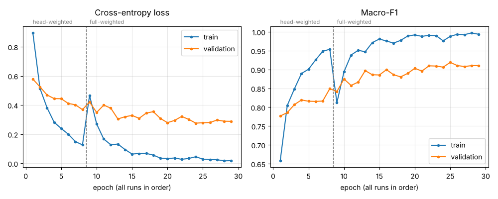
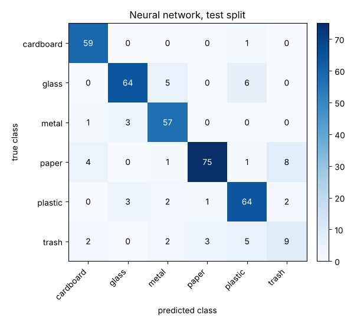
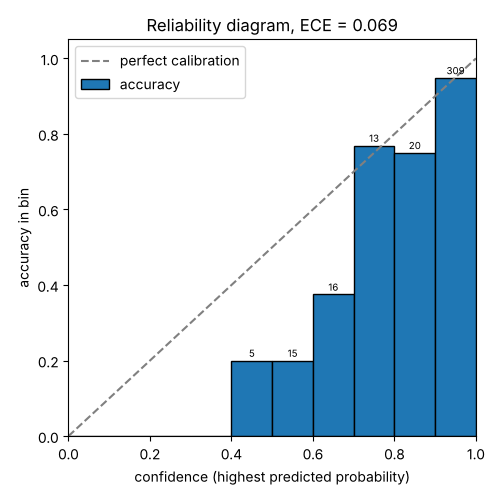

# Evaluation

All results use the fixed split in [splits/trashnet-split.csv](../splits/trashnet-split.csv) (SHA-256 `29db88fff705dfe6ee2ca24eec9e99fe4d494f4ecea9bdb36b06a39f4907e419`, 1,765 train, 378 validation and 378 test images, see [dataset.md](dataset.md)). Models and settings are chosen on the validation split only. Each final model is evaluated once on the test split. The main metric is macro-F1, because the classes are imbalanced (the test split has 21 trash images and 89 paper images).

## Classical baseline

The baseline shows how far hand-crafted image features get before any deep learning is used.

### Features

Every image is converted to RGB and resized to 128 × 128 pixels. Three descriptors are concatenated into one vector of 1,902 values:

| Descriptor | Settings | Values | What it captures |
|---|---|---|---|
| HSV colour histogram | 8 hue × 4 saturation × 4 value bins, normalised to sum 1 | 128 | Overall colour, independent of where it is in the image |
| Local binary patterns (LBP) | Grayscale, uniform patterns, 8 neighbours, radius 1, normalised histogram | 10 | Fine surface texture (smooth, edges, corners, spots) |
| Histogram of oriented gradients (HOG) | Grayscale, 9 orientations, 16 × 16 pixel cells, 2 × 2 cell blocks | 1,764 | Shape: the direction of edges in each region of the image |

The features are computed with scikit-image ([src/wastevision/baseline/features.py](../src/wastevision/baseline/features.py)).

### Model selection on validation

Each candidate is a scikit-learn pipeline that standardises the features and then fits the classifier on the train split. It is scored on the validation split, and the candidate with the highest validation macro-F1 is kept (on a tie, the first one in the table).

| Model | Parameters | Validation accuracy | Validation macro-F1 |
|---|---|---|---|
| Logistic regression | C = 0.001 | 0.672 | 0.657 |
| **Logistic regression** | **C = 0.01** | **0.704** | **0.699** |
| Logistic regression | C = 0.1 | 0.693 | 0.682 |
| Logistic regression | C = 1 | 0.693 | 0.680 |
| SVM, RBF kernel | C = 1, gamma = scale | 0.672 | 0.653 |
| SVM, RBF kernel | C = 1, gamma = 0.0001 | 0.611 | 0.541 |
| SVM, RBF kernel | C = 10, gamma = scale | 0.698 | 0.693 |
| SVM, RBF kernel | C = 10, gamma = 0.0001 | 0.688 | 0.678 |
| SVM, RBF kernel | C = 100, gamma = scale | 0.698 | 0.693 |
| SVM, RBF kernel | C = 100, gamma = 0.0001 | 0.696 | 0.693 |

The selected model is logistic regression with C = 0.01, a strongly regularised linear model. The best RBF SVMs are close behind (0.693), so the extra flexibility of a non-linear kernel does not help with these features.

### Test result

The selected pipeline was evaluated once on the test split (378 images):

| Metric | Value |
|---|---|
| Accuracy | 0.730 |
| Macro-F1 | 0.720 |

| Class | Precision | Recall | F1 | Test images |
|---|---|---|---|---|
| cardboard | 0.833 | 0.833 | 0.833 | 60 |
| glass | 0.692 | 0.720 | 0.706 | 75 |
| metal | 0.638 | 0.607 | 0.622 | 61 |
| paper | 0.817 | 0.854 | 0.835 | 89 |
| plastic | 0.627 | 0.653 | 0.640 | 72 |
| trash | 0.857 | 0.571 | 0.686 | 21 |

The test scores are slightly higher than the validation scores. With 378 images, one image changes accuracy by about 0.3 percentage points, so a difference of this size is within the normal variation between two samples of the same data.

Cardboard and paper are recognised best: they have typical colours and flat textures. Glass, metal and plastic are confused with each other most often: the largest errors in the test confusion matrix are glass predicted as plastic (11 images) and metal predicted as glass or plastic (9 images each). A likely reason is that these materials are shiny, often transparent or grey, and their appearance depends on reflections that colour, texture and edge histograms describe poorly. Trash has a high precision but a low recall: the model predicts it only 14 times for 21 trash images, which fits the small number of trash images in training.

### Reproduce

```bash
pip install -e ".[train,dev]"
wastevision data download
wastevision baseline train
wastevision baseline evaluate
```

`baseline train` prints the validation table and saves the selected pipeline to `runs/baseline/model.joblib` (not committed). `baseline evaluate` loads it and prints the test metrics. Both commands are deterministic: running them again gives the same numbers.

Measured on 2026-10-23 on a 4-core Intel Xeon CPU at 2.10 GHz with Python 3.12.3, scikit-learn 1.9.1 and scikit-image 0.26.0: feature extraction takes about 11 ms per image, `baseline train` about 70 seconds in total (feature extraction for train and validation plus all ten candidates), `baseline evaluate` about 6 seconds.

## Neural network

The network is MobileNetV3-Small, pretrained on ImageNet (`IMAGENET1K_V1` weights from torchvision), with its last layer replaced by a new layer with one output per class. It is trained in two stages on the train split, and every choice below was made on the validation split only. The final model was then evaluated once on the test split ([Test result](#test-result-1)).

### Training settings

| Setting | Stage 1: head | Stage 2: full network |
|---|---|---|
| Trainable layers | classifier only (backbone frozen, BatchNorm statistics fixed) | all layers |
| Starting weights | ImageNet backbone, new random last layer | best stage 1 checkpoint |
| Optimizer | AdamW, learning rate 1e-3 | AdamW, learning rate 1e-4 for the backbone and 1e-3 for the classifier |
| Learning-rate schedule | constant | cosine decay over 25 epochs |
| Epochs | 8 | at most 25, early stopping when validation macro-F1 has not improved for 4 epochs |
| Loss | cross-entropy with inverse-frequency class weights | same |
| Batch size, seed | 32, 42 | 32, 42 |

After every epoch the model is evaluated on validation, and the checkpoint with the highest validation macro-F1 is kept.

### Class weights

Trash has only 95 training images, against 416 for paper. Weighting the loss by inverse class frequency makes a mistake on a rare class cost more. Both options were trained through both stages and compared on validation:

| Loss | Stage 1 val macro-F1 | Stage 2 best epoch | Stage 2 val accuracy | Stage 2 val macro-F1 |
|---|---|---|---|---|
| unweighted | 0.8575 | 8 of 12 | 0.9206 | 0.9127 |
| inverse-frequency class weights | 0.8493 | 17 of 21 | **0.9259** | **0.9189** |

The weighted loss is slightly better after fine-tuning and is the default. The difference is small (two more validation images correct out of 378), so it is a weak preference, not a strong result. For comparison, the classical baseline reaches a validation macro-F1 of 0.699.

### Training curves



Training loss keeps falling, while validation loss levels off at about 0.28 from epoch 12 of stage 2 and training macro-F1 approaches 1.0. This growing gap is the sign of overfitting that early stopping reacts to. The jump in training loss at the start of stage 2 comes from unfreezing the backbone: its BatchNorm layers start updating their statistics and the pretrained features begin to change.

### Reproduce

```bash
pip install -e ".[train,dev]"
wastevision data download
wastevision train --stage head
wastevision train --stage full
wastevision curves --run runs/head --run runs/full
```

`train` prints one line per epoch and writes `metrics.csv` and the best checkpoint `best.pt` to `runs/head` or `runs/full` (not committed). `--no-class-weights`, `--epochs` and `--run-dir` change the settings. The comparison above used `--run-dir` to keep the four runs apart. Measured on 2026-10-27 on a 4-core Intel Xeon CPU at 2.10 GHz with PyTorch 2.14.1: stage 1 takes about 3 minutes, stage 2 about 13 minutes (about 38 seconds per epoch).

### Test result

The final model (stage 2 with class weights, best epoch 17, validation macro-F1 0.919) was evaluated once on the test split (378 images). Nothing was changed after seeing these numbers.

| Model | Test accuracy | Test macro-F1 |
|---|---|---|
| Classical baseline (logistic regression on colour, texture and shape features) | 0.730 | 0.720 |
| **MobileNetV3-Small, fine-tuned** | **0.868** | **0.819** |

| Class | Precision | Recall | F1 | Baseline F1 | Test images |
|---|---|---|---|---|---|
| cardboard | 0.894 | 0.983 | 0.937 | 0.833 | 60 |
| glass | 0.914 | 0.853 | 0.883 | 0.706 | 75 |
| metal | 0.851 | 0.934 | 0.891 | 0.622 | 61 |
| paper | 0.949 | 0.843 | 0.893 | 0.835 | 89 |
| plastic | 0.831 | 0.889 | 0.859 | 0.640 | 72 |
| trash | 0.474 | 0.429 | 0.450 | 0.686 | 21 |



The network is clearly better than the baseline for five of the six classes, with the largest gains for metal (+0.27 F1), plastic (+0.22) and glass (+0.18), the shiny materials that the hand-crafted features confused most. Trash is the exception: the network finds only 9 of the 21 trash images, and 10 of its 19 trash predictions are wrong (8 of them are paper). The baseline does better on this class (F1 0.686).

The test result is lower than the validation result (accuracy 0.868 against 0.926, macro-F1 0.819 against 0.919). That is 22 more wrong images out of 378, more than the usual variation between two samples of this size. Two reasons are known: the epoch and the loss were chosen because they scored best on validation, so the validation score is optimistic by design; and trash has only 21 images in each split, so each trash image moves its recall by about 5 percentage points. Most of the gap comes from trash (validation F1 0.857, test 0.450) and from paper predicted as trash. The test score is the one to report, and the error analysis looks at these mistakes in detail.

### Calibration

A model is well calibrated when its confidence matches how often it is right: of all the images it classifies with 80% confidence, about 80% should be correct. Calibration matters here because the service will answer "unsure" when the confidence is low, and that threshold only works if the confidence means something.

The confidence of a prediction is its highest softmax probability. The test predictions are sorted into 10 equal-width confidence bins, and for each bin the accuracy is compared with the mean confidence. The expected calibration error (ECE) is the average gap between the two, weighted by the share of images in each bin.

| Confidence | Images | Mean confidence | Accuracy |
|---|---|---|---|
| 0.4 to 0.5 | 5 | 0.439 | 0.200 |
| 0.5 to 0.6 | 15 | 0.551 | 0.200 |
| 0.6 to 0.7 | 16 | 0.647 | 0.375 |
| 0.7 to 0.8 | 13 | 0.740 | 0.769 |
| 0.8 to 0.9 | 20 | 0.855 | 0.750 |
| 0.9 to 1.0 | 309 | 0.990 | 0.948 |

No prediction had a confidence below 0.4. **ECE on the test split: 0.069.**



The model is overconfident: in almost every bin the accuracy is below the confidence (bars under the diagonal). The effect is strongest for uncertain predictions (only 10 of the 36 images with a confidence below 0.7 are correct), and it matters most for the top bin, which holds 82% of the images: their mean confidence is 0.990, but 5.2% of them are wrong. Still, low confidence does point to likely mistakes, which is what an "unsure" answer needs. Its threshold will be chosen on the validation split.

### Reproduce

```bash
wastevision evaluate
```

`evaluate` loads `runs/full/best.pt` (the checkpoint from the training commands above), predicts the test split, prints the metrics, the confusion matrix and the calibration table, and writes [img/confusion-matrix.png](img/confusion-matrix.png) and [img/reliability-diagram.png](img/reliability-diagram.png). The metrics and the calibration error are computed with the project's own NumPy code ([src/wastevision/evaluation/](../src/wastevision/evaluation/)), which is checked against scikit-learn in the tests. Measured on 2026-10-28 on a 4-core Intel Xeon CPU at 2.10 GHz with PyTorch 2.14.1: about 8 seconds.
